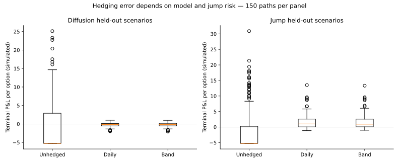
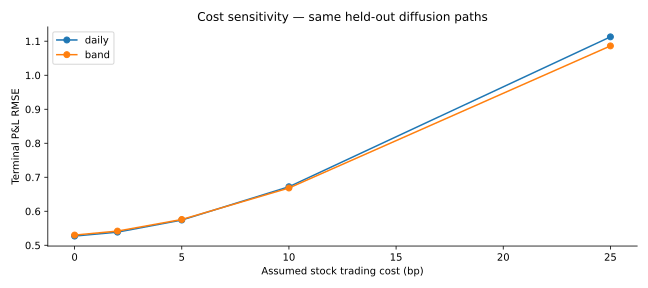
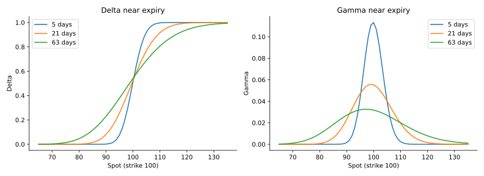
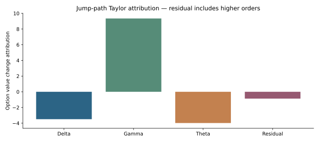

> **Consolidated research, 24 October 2026:** The expanded version of this work is maintained in [derivatives-hedging-research](https://github.com/Anjaney336/derivatives-hedging-research), with a [research dashboard](https://anjaney336.github.io/portfolio/research/derivatives-hedging-research/). This repository preserves the earlier implementation and results.

# Options Greeks & Hedging Lab

**European option analytics, self-financing hedge accounting and held-out stress experiments.**

[Visual research report](https://anjaney336.github.io/portfolio/options-hedging/) · Anjaney Malhotra

## Research question
How much discrete hedging error remains after trading costs, and how does a delta-band policy behave when the Black-Scholes diffusion assumption breaks?

This is a pricing and hedge-validation project, not a historical options trading strategy. There are no actual option-chain quotes in this dataset. AI-assisted code; reproduce and understand it before presenting independent ownership.

## Results
- **20 tests**: known option price, put–call parity, all five Greeks checked against numerical derivatives, IV round-trip, expiry, self-financing identities, future-data mutation, cost direction and terminal liquidation.
- Select the delta band from 0.02 / 0.05 / 0.10 using **50 training paths only**; freeze it at **0.02** before evaluation.
- **900 held-out policy evaluations**: 150 paths × 2 regimes × 3 policies (unhedged, daily delta, delta band).
- Diffusion terminal P&L RMSE: **7.036 unhedged, 0.574 daily, 0.576 band**. Jump/regime RMSE: **7.584, 2.945, 2.940**, respectively. Units are currency per option on normalized spot 100, not portfolio return percentages.
- Daily diffusion mean P&L is **−0.216** after stock-hedge costs. The band does not materially beat daily hedging in this experiment. Positive mean jump-case P&L reflects an option priced with a misspecified constant volatility, not an executable alpha claim.
- **29 non-overlapping DLF underlying-price replay blocks** are published separately. Their calls, premiums, strikes and expiries are hypothetical, using a preceding-60-return volatility proxy. They are NOT observed option returns.






## Reproduce
Python 3.12:
```
python -m pip install -r requirements.txt
python -m unittest -v
python run.py
```
Optional historical-underlying replay, using a locally permitted vendor-adjusted-price export:
```
python run.py --historical-csv path/to/prices.csv --column DLF.NS
```
CSV schema: `Date,DLF.NS` (other columns allowed). Dates must be chronological; positive prices only. Raw vendor prices are not redistributed. Re-fetching data can revise the source history; match the committed SHA-256 to reproduce the original replay. Synthetic results do not require external data.

## Methodology
`pricing.py` implements European Black-Scholes calls and puts without dividends, with delta, gamma, vega, theta and rho. Vega/rho are per unit change; theta is per year. At expiry the price is intrinsic value; the ATM delta convention is 0.5 and other terminal Greeks are set to zero as implementation conventions. Implied volatility uses a bracketed bisection with price validation.

`hedging.py` holds one long ATM call, finances its premium and shorts delta units of stock. Cash accrues at the assumed funding rate, rebalancing pays proportional stock costs and expiry closes the hedge. Every run verifies:

terminal P&L = option value change + stock holding P&L + financing interest − hedge transaction costs.

The option-value attribution uses lagged delta × spot change + 0.5 × gamma × squared spot change + theta × elapsed time; the residual preserves higher-order/jump error. Vega and rho are validated analytically but are not trading signals; pricing IV and rates are constant within a run. Do not describe the project as volatility-surface calibration, delta-gamma-neutral trading or a gamma-scalping profit record.

## Data provenance and assumptions
1. **Synthetic source:** [hedging.py generator](https://github.com/Anjaney336/options-greeks-hedging-lab/blob/main/hedging.py), generated/accessed 24 October 2026. Training seeds 0–49; evaluation 1000–1149. 63 steps, dt1/252, normalized spot/strike100, pricing vol25%, rate2%, stock cost5bp, multiplier1. Diffusion realized vol25%; stress switches15%→35% with 2.5% per-step jump chance and normal log jump mean−4%, SD8%. These are assumptions, not calibrated market estimates.
2. **Underlying replay source:** [Yahoo Finance DLF history](https://finance.yahoo.com/quote/DLF.NS/history/), previously cached vendor-adjusted closes, accessed for replay 24 October 2026. Cache hash and model assumptions are in results/summary.json. No raw prices are published. Adjusted prices are a total-return proxy; dt1/252 ignores calendar gaps and dividend/contract conventions. This is deliberately separate from actual option-chain evidence.
3. **Method reference:** [Options Industry Council — Greeks](https://prd-web.optionseducation.org/advancedconcepts/understanding-options-greeks), accessed 24 October 2026. Greeks are model sensitivities, not guaranteed price moves.
4. **Data gap:** [Cboe historical option quote intervals](https://datashop.cboe.com/option-quote-intervals), accessed 24 October 2026, identifies a potential quote source; no data were purchased or used from it.

## Limitations and next empirical test
Same-close analytic hedge execution is idealized. No option bid/ask spread, premium fees, stock borrow cost, margin, tax, dividends, funding asymmetry or market impact. Short stock and fractional quantities are assumed available. Sample sizes are finite and policy selection is specific to the synthetic training generator. Real option testing needs legally usable time-stamped contract quotes, expiries, corporate actions, bid/ask executions and verified borrow. No broker API or live order submission.

